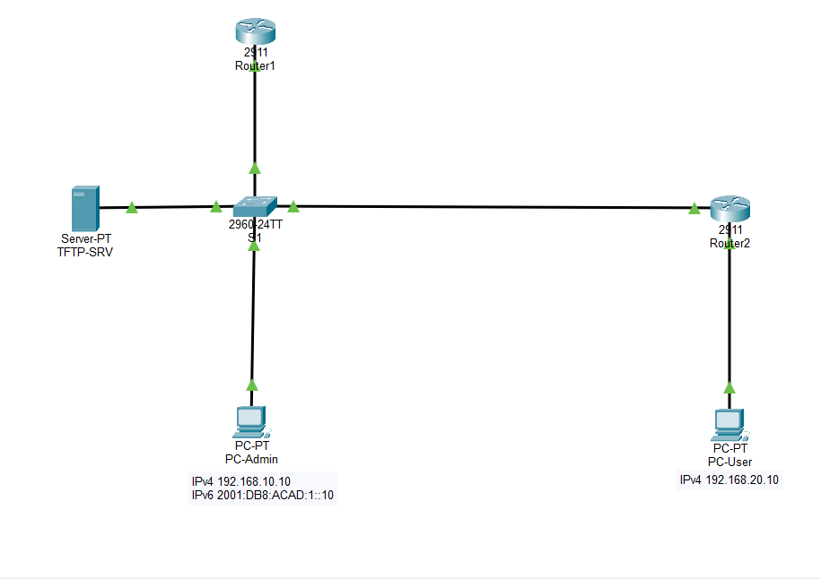

# 02 - Basic Configurations, SSH and Telnet

## Project Overview

This project demonstrates the basic configuration and security of Cisco network devices using **Cisco Packet Tracer**.

It covers device initialization, interface configuration, IPv4 and IPv6 addressing, remote management using SSH, network connectivity verification, device discovery protocols, and configuration backup using a TFTP server.

## Network Topology

The network consists of:

- 2 Routers (R1 and R2)
- 1 Layer 2 Switch (SW1)
- 2 PCs (PC-Admin and PC-User)
- 1 TFTP Server

### Topology Diagram



## Network Addressing

| Device | Interface | IP Address | Subnet Mask / Prefix |
|---|---|---|---|
| R1 | G0/0 | 192.168.10.1 | /24 |
| R1 | G0/0 | 2001:DB8:ACAD:1::1 | /64 |
| R1 | Loopback0 | 10.1.1.1 | /32 |
| R2 | G0/0 | 192.168.10.3 | /24 |
| R2 | G0/1 | 192.168.20.1 | /24 |
| SW1 | VLAN 10 | 192.168.10.2 | /24 |
| PC-Admin | FastEthernet0 | 192.168.10.10 | /24 |
| PC-Admin | IPv6 | 2001:DB8:ACAD:1::10 | /64 |
| PC-User | FastEthernet0 | 192.168.20.10 | /24 |
| TFTP-SRV | FastEthernet0 | 192.168.10.20 | /24 |

### Default Gateways

- PC-Admin: `192.168.10.1`
- PC-User: `192.168.20.1`
- TFTP Server: `192.168.10.1`
- SW1: `192.168.10.1`

## Configuration Tasks

### 1. Basic Device Configuration

- Hostname configuration.
- Enable secret password.
- Password encryption.
- Minimum password length.
- Login blocking configuration where supported.
- Console and VTY line security.
- MOTD banner configuration.

### 2. Interface Configuration

- IPv4 and IPv6 address assignment.
- Interface activation using `no shutdown`.
- Interface range configuration.
- Loopback interface configuration.
- Switch management SVI configuration.
- Default gateway configuration.

### 3. Remote Management

- Local user account configuration.
- RSA key generation.
- SSH version 2 configuration.
- Secure remote access through VTY lines.
- SSH connectivity testing from PC-Admin.

### 4. Network Connectivity

- Static routing between the two LAN networks.
- IPv4 and IPv6 connectivity testing.
- Ping and traceroute commands.
- Interface status verification.

### 5. Network Discovery

- CDP neighbor discovery.
- LLDP neighbor discovery.
- Verification of connected network devices.

### 6. Configuration Management and Backup

- Running-config and startup-config management.
- Saving configurations to NVRAM.
- Configuration backup to a TFTP server.
- Backup files created for R1, R2, and SW1.

### 7. Verification and Troubleshooting

The project includes practical use of commands such as:

```cisco
show ip interface brief
show ipv6 interface brief
show running-config
show startup-config
show vlan brief
show ip route
show cdp neighbors
show lldp neighbors
show version
ping
traceroute
```

## Verification Results

The following tests were completed successfully:

- PC-Admin successfully reached R1, R2, SW1, and the TFTP Server.
- PC-Admin successfully tested IPv6 connectivity with R1.
- PC-User successfully reached its default gateway and the management network.
- SSH access from PC-Admin to R1, R2, and SW1 was successful.
- CDP and LLDP successfully identified neighboring devices.
- Network interfaces and VLAN 10 were verified.
- Configuration backups were successfully transferred to the TFTP Server.

## SSH and Telnet Note

SSH version 2 was configured and successfully tested on the network devices.

Telnet configuration was also studied as part of the project. However, the Packet Tracer IOS image used in this lab did not support the required combined SSH and Telnet VTY transport configuration. Therefore, Telnet was not included as a successfully tested feature.

## Technologies and Tools

- Cisco Packet Tracer
- Cisco IOS CLI
- IPv4 and IPv6
- SSH
- VLAN
- Static Routing
- CDP and LLDP
- TFTP
- Network Troubleshooting

## Project Files

```text
02-Basic-Configurations-SSH-Telnet/
│
├── README.md
├── Basic-Configurations-SSH-Telnet.pkt
└── topology.png
```

## Learning Objectives

Through this project, I practiced configuring Cisco network devices, securing administrative access, managing network interfaces, enabling remote management, verifying connectivity, discovering neighboring devices, and backing up device configurations.

---

**Project 02 | CCNA Networking Projects**  
*Hands-on Networking Labs using Cisco Packet Tracer*