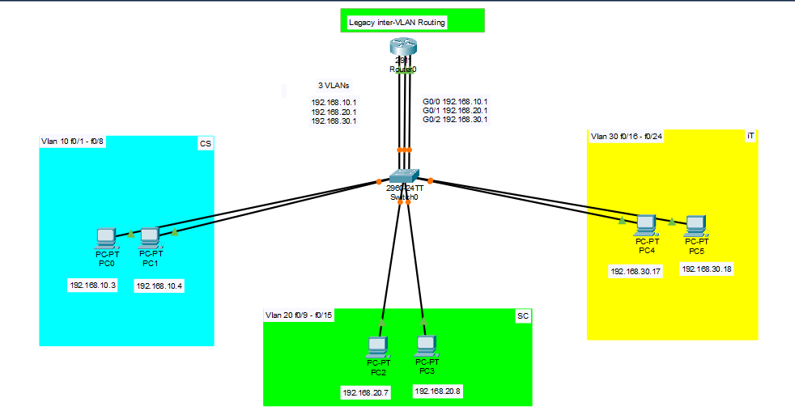
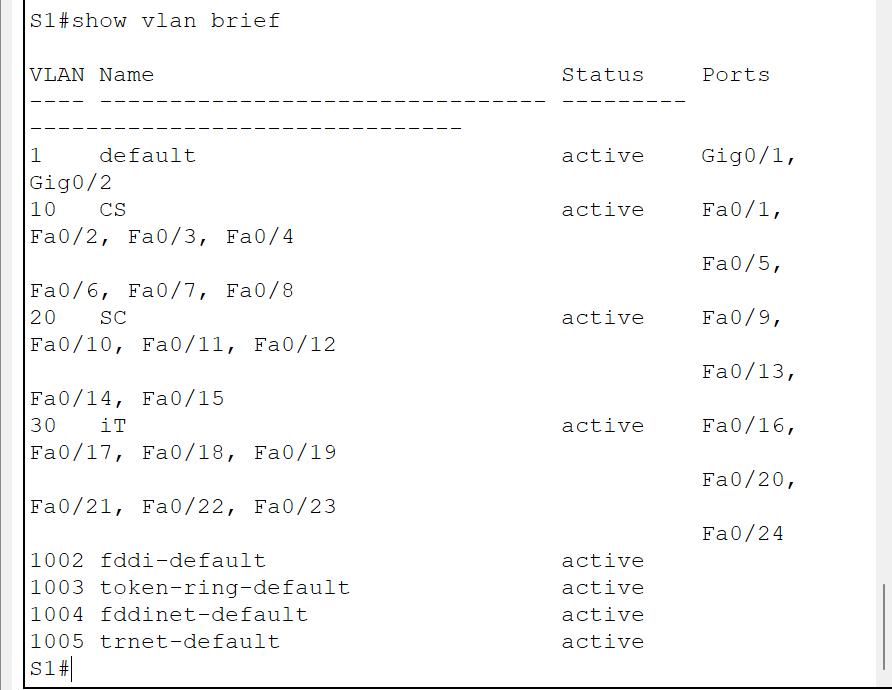
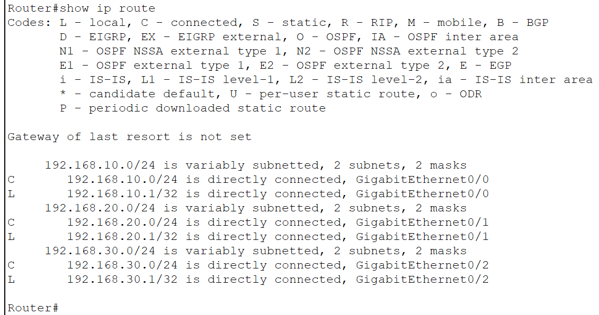
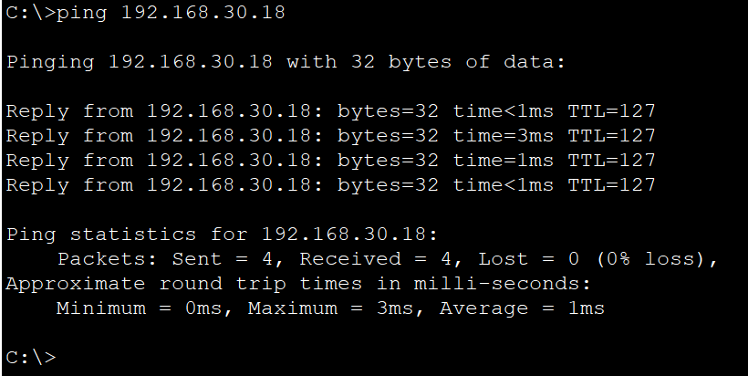

# Project 03: Legacy Inter-VLAN Routing

## Overview

This project demonstrates Legacy Inter-VLAN Routing using Cisco Packet Tracer.

The network consists of three separate VLANs connected to a Cisco 2911 router through three dedicated physical interfaces. Each router interface acts as the default gateway for its corresponding VLAN, enabling communication between different networks.

## Network Topology

- 1 Cisco 2911 Router
- 1 Cisco 2960 Switch
- 6 PCs
- 3 VLANs
- Cisco Packet Tracer

## VLAN and IP Addressing

| VLAN | Name | Network | Default Gateway |
|---|---|---|---|
| 10 | CS | 192.168.10.0/24 | 192.168.10.1 |
| 20 | SC | 192.168.20.0/24 | 192.168.20.1 |
| 30 | iT | 192.168.30.0/24 | 192.168.30.1 |

## IP Address Assignment

| Device | IP Address | VLAN |
|---|---|---|
| PC1 | 192.168.10.3 | 10 |
| PC2 | 192.168.10.4 | 10 |
| PC3 | 192.168.20.7 | 20 |
| PC4 | 192.168.20.8 | 20 |
| PC5 | 192.168.30.17 | 30 |
| PC6 | 192.168.30.18 | 30 |

## Router Configuration

Each physical router interface was configured as the default gateway for its corresponding VLAN.

```cisco
interface GigabitEthernet0/0
 ip address 192.168.10.1 255.255.255.0
 no shutdown

interface GigabitEthernet0/1
 ip address 192.168.20.1 255.255.255.0
 no shutdown

interface GigabitEthernet0/2
 ip address 192.168.30.1 255.255.255.0
 no shutdown
```

## Switch Configuration

Three VLANs were created and assigned to the following switch ports:

| VLAN | Assigned Ports |
|---|---|
| VLAN 10 | Fa0/1 – Fa0/8 |
| VLAN 20 | Fa0/9 – Fa0/15 |
| VLAN 30 | Fa0/16 – Fa0/24 |

## Verification and Testing

The following commands were used to verify the network configuration:

```cisco
show ip interface brief
show ip route
show vlan brief
show interfaces status
```

Connectivity was tested using ICMP Ping between devices in different VLANs.

**Result:** All tested connectivity checks were successful, confirming that inter-VLAN routing was working correctly.

## Key Concepts Learned

- VLAN creation and configuration.
- Assigning switch ports to VLANs.
- IPv4 addressing and subnetting.
- Configuring physical router interfaces.
- Legacy Inter-VLAN Routing.
- Understanding default gateways.
- Verifying network connectivity.
- Using Cisco IOS verification commands.

## Screenshots

### Network Topology


### VLAN Configuration


### Routing Table


### Connectivity Testing


## Project File

The Cisco Packet Tracer project file is included:

`Legacy-Inter-VLAN-Routing.pkt`

---

**Project 03/30 — CCNA Networking Projects**