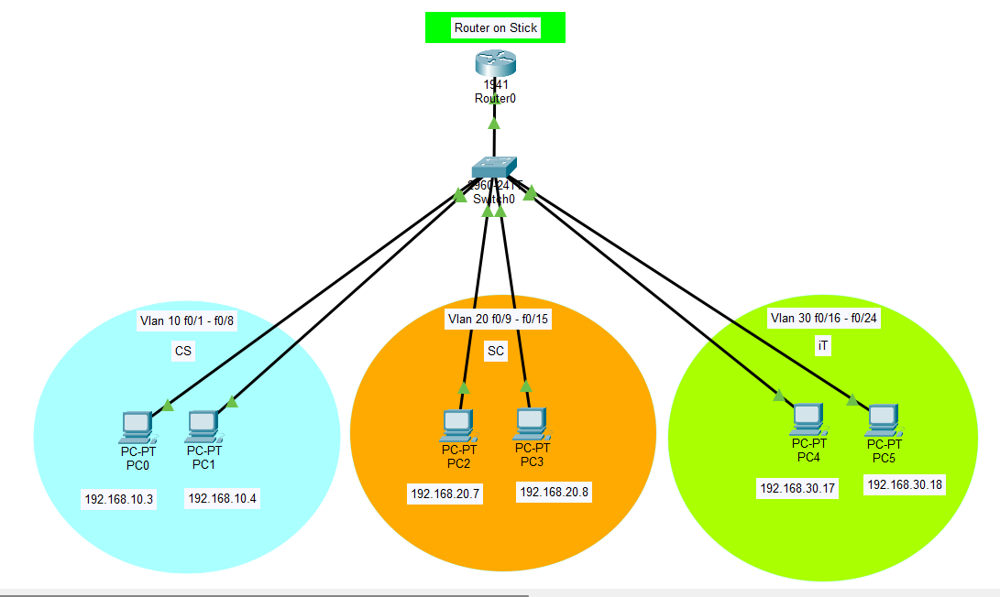
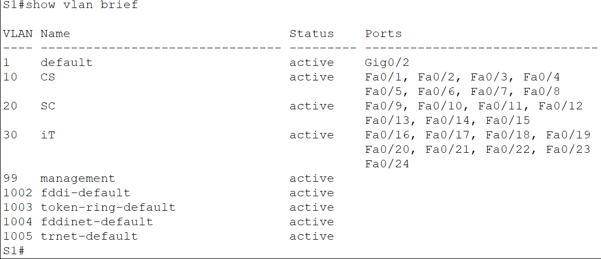
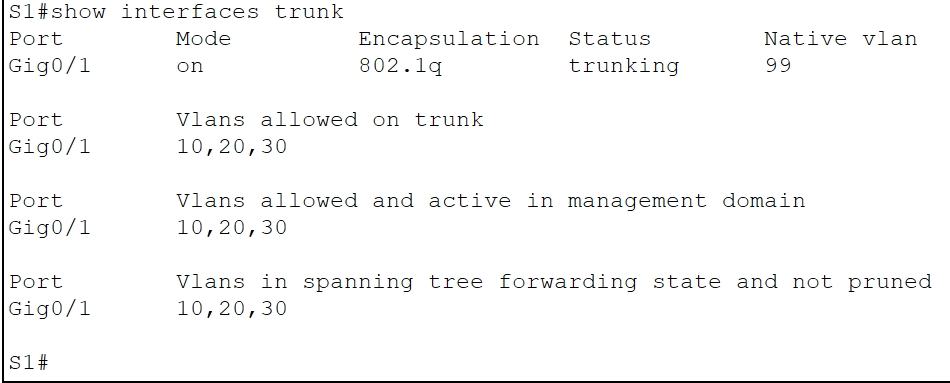
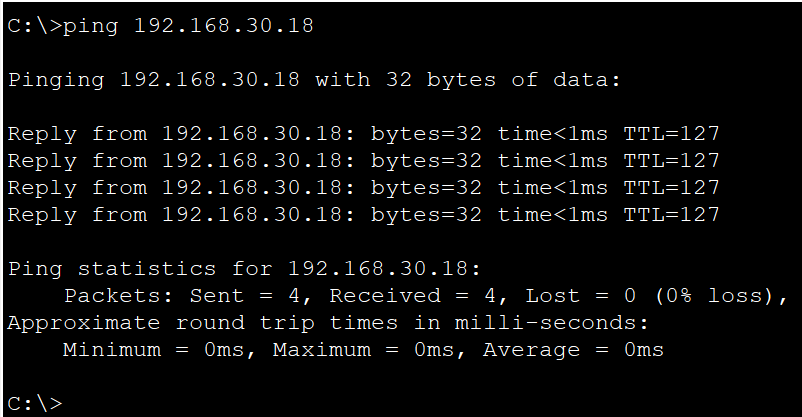

# Project 04: Router-on-a-Stick

## Overview

This project demonstrates Inter-VLAN Routing using the Router-on-a-Stick method in Cisco Packet Tracer.

The network consists of three VLANs connected to a Cisco 1941 router through a single 802.1Q trunk link.

The router uses subinterfaces to provide a default gateway for each VLAN, allowing devices in different VLANs to communicate with each other.

## Project Objectives

- Create and configure three VLANs.
- Assign switch access ports to the appropriate VLANs.
- Configure an 802.1Q trunk link between the switch and router.
- Create router subinterfaces for each VLAN.
- Configure IPv4 addressing and default gateways.
- Verify inter-VLAN routing and network connectivity.
- Compare Router-on-a-Stick with Legacy Inter-VLAN Routing.

## Network Topology

### Devices Used

- 1 Cisco 1941 Router
- 1 Cisco 2960 Switch
- 6 PCs
- Cisco Packet Tracer

### Physical Connection

- Router interface: `GigabitEthernet0/0`
- Switch interface: `GigabitEthernet0/1`
- Connection type: 802.1Q Trunk

The trunk link carries traffic for VLANs 10, 20, and 30.

## VLAN and IP Addressing

| VLAN | Name | Network | Default Gateway |
|---|---|---|---|
| 10 | CS | 192.168.10.0/24 | 192.168.10.1 |
| 20 | SC | 192.168.20.0/24 | 192.168.20.1 |
| 30 | iT | 192.168.30.0/24 | 192.168.30.1 |

## IP Address Assignment

| Device | IP Address | Default Gateway |
|---|---|---|
| PC0 | 192.168.10.3/24 | 192.168.10.1 |
| PC1 | 192.168.10.4/24 | 192.168.10.1 |
| PC2 | 192.168.20.7/24 | 192.168.20.1 |
| PC3 | 192.168.20.8/24 | 192.168.20.1 |
| PC4 | 192.168.30.17/24 | 192.168.30.1 |
| PC5 | 192.168.30.18/24 | 192.168.30.1 |

## Switch Configuration

Three VLANs were created and assigned to the following access ports:

| VLAN | Assigned Ports |
|---|---|
| VLAN 10 | Fa0/1 – Fa0/8 |
| VLAN 20 | Fa0/9 – Fa0/15 |
| VLAN 30 | Fa0/16 – Fa0/24 |

The switch interface `Gig0/1`, connected to the router, was configured as an 802.1Q trunk.

The trunk was configured to allow VLANs 10, 20, and 30.

### Native VLAN

VLAN 99 was configured with the name `management` as the native VLAN on the trunk link. It was not included in the allowed VLAN list in the final configuration.

## Router Configuration

The router uses one physical interface with three subinterfaces.

```cisco
interface GigabitEthernet0/0
 no ip address
 no shutdown

interface GigabitEthernet0/0.10
 encapsulation dot1Q 10
 ip address 192.168.10.1 255.255.255.0

interface GigabitEthernet0/0.20
 encapsulation dot1Q 20
 ip address 192.168.20.1 255.255.255.0

interface GigabitEthernet0/0.30
 encapsulation dot1Q 30
 ip address 192.168.30.1 255.255.255.0
```

### Subinterface Assignment

| Subinterface | VLAN | Default Gateway |
|---|---|---|
| G0/0.10 | 10 | 192.168.10.1 |
| G0/0.20 | 20 | 192.168.20.1 |
| G0/0.30 | 30 | 192.168.30.1 |

Each subinterface handles traffic for its corresponding VLAN using 802.1Q encapsulation.

## Verification and Testing

The following Cisco IOS commands were used to verify the configuration.

### Router Verification

```cisco
show ip interface brief
show ip route
show running-config
```

Verification results:

- The physical interface and all three subinterfaces were up/up.
- Each subinterface had the correct gateway address.
- All three VLAN networks appeared as directly connected routes.

### Switch Verification

```cisco
show vlan brief
show interfaces trunk
show interfaces status
```

Verification results:

- Access ports were assigned to the correct VLANs.
- Gig0/1 was operating in trunking mode.
- 802.1Q encapsulation was confirmed.
- VLANs 10, 20, and 30 were allowed on the trunk.

### Connectivity Testing

ICMP Ping tests were performed between devices in different VLANs.

**Result:** All tested pings were successful, confirming that inter-VLAN routing was working correctly.

## Comparison: Legacy Inter-VLAN Routing vs. Router-on-a-Stick

| Feature | Legacy Inter-VLAN Routing | Router-on-a-Stick |
|---|---|---|
| Router Connections | One physical link per VLAN | One trunk link for multiple VLANs |
| Router Interfaces | Physical interfaces | Subinterfaces |
| VLAN Identification | Separate physical links | 802.1Q tagging |
| Cable Requirements | More physical connections | Fewer physical connections |
| Scalability | Limited by available physical interfaces | Easier to add VLAN subinterfaces, subject to device support |
| Main Consideration | Uses more router interfaces | All inter-VLAN traffic shares one physical trunk link |

In the previous project, I used a dedicated physical router interface for each VLAN.

In this project, I used a single trunk connection with multiple router subinterfaces, reducing the number of physical connections required.

## Key Concepts Learned

- VLAN creation and configuration.
- Access port assignment.
- 802.1Q trunk configuration.
- VLAN tagging.
- Router subinterfaces.
- IPv4 addressing and default gateways.
- Inter-VLAN Routing.
- Routing table verification.
- Network connectivity testing.
- Comparing different Inter-VLAN Routing methods.

## Screenshots

### 1. Network Topology



### 2. VLAN Configuration



### 3. Trunk Configuration



### 4. Connectivity Testing



## Project File

The Cisco Packet Tracer simulation file is included:

`Router-on-a-Stick.pkt`

---

**Project 04/30 — CCNA Networking Projects**

Learn. Practice. Build.