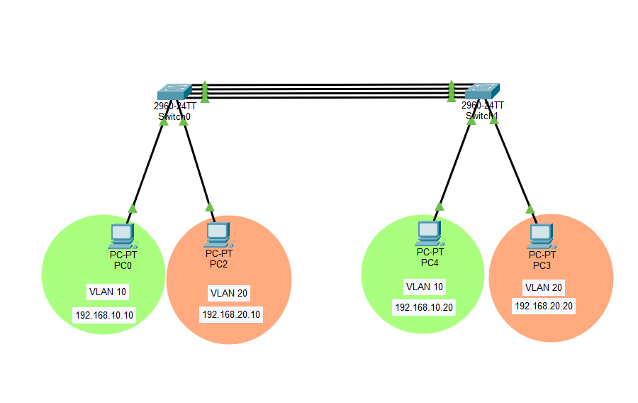
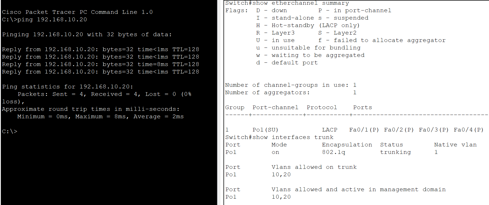

# Project 06: Link Aggregation – EtherChannel (LACP) with VLAN Trunking

## Overview

This project demonstrates Link Aggregation using **EtherChannel with LACP** and VLAN Trunking in Cisco Packet Tracer.

The network consists of two Cisco Catalyst 2960 switches connected through four physical FastEthernet links bundled into a single logical link called **Port-channel 1**.

LACP (Link Aggregation Control Protocol) is configured in **Active mode** on both switches to negotiate and establish the EtherChannel.

The Port-channel is configured as an 802.1Q trunk, allowing VLAN 10 and VLAN 20 traffic to pass between the switches.

## Network Topology

- **2x Cisco Catalyst 2960-24TT Switches**
- **4x PCs**
- **4x FastEthernet links** between the switches
- **1x EtherChannel (Port-channel 1)** using LACP
- **2x VLANs:** VLAN 10 (Engineering) and VLAN 20 (Sales)

## Network Configuration

### 1. VLAN Configuration

Two VLANs were created on both switches:

| VLAN ID | VLAN Name | Purpose |
|---|---|---|
| 10 | Engineering | Engineering Department |
| 20 | Sales | Sales Department |

### 2. IP Addressing

| Device | Switch | Port | VLAN | IP Address | Subnet Mask |
|---|---|---|---|---|---|
| PC0 | Switch0 | Fa0/5 | 10 | 192.168.10.10 | 255.255.255.0 |
| PC1 | Switch0 | Fa0/6 | 20 | 192.168.20.10 | 255.255.255.0 |
| PC2 | Switch1 | Fa0/5 | 10 | 192.168.10.20 | 255.255.255.0 |
| PC3 | Switch1 | Fa0/6 | 20 | 192.168.20.20 | 255.255.255.0 |

### 3. Access Port Configuration

The PC-facing ports were assigned to their respective VLANs:

```bash
interface fastEthernet 0/5
 switchport mode access
 switchport access vlan 10
 spanning-tree portfast
exit

interface fastEthernet 0/6
 switchport mode access
 switchport access vlan 20
 spanning-tree portfast
exit
```

### 4. EtherChannel Configuration (LACP)

Four physical FastEthernet interfaces were bundled into Port-channel 1 using LACP Active mode.

The following configuration was applied on both switches:

```bash
interface range fastEthernet 0/1 - 4
 shutdown
 channel-group 1 mode active
 no shutdown
exit

interface port-channel 1
 switchport mode trunk
 switchport trunk allowed vlan 10,20
exit
```

For a controlled configuration process, the member interfaces were temporarily shut down before assigning them to the EtherChannel.

## Key Technologies

### 1. EtherChannel

EtherChannel combines multiple physical links into one logical link, providing:

- Increased available bandwidth.
- Link redundancy.
- Improved network availability.
- Simplified link management.

### 2. LACP (Link Aggregation Control Protocol)

LACP is an open-standard protocol defined historically by IEEE 802.3ad and currently standardized as IEEE 802.1AX.

It supports two negotiation modes:

- **Active:** Actively sends LACP negotiation packets.
- **Passive:** Waits for LACP negotiation packets.

In this project, both switches use Active mode.

### 3. VLAN Trunking

The Port-channel interface operates as an 802.1Q trunk, allowing traffic from VLAN 10 and VLAN 20 to pass through the logical link between the switches.

### 4. Spanning Tree Protocol (STP)

STP treats the EtherChannel as a single logical link rather than four separate physical links, helping prevent Layer 2 switching loops.

## Verification Commands

The following commands were used to verify the configuration:

```bash
show etherchannel summary
show interfaces trunk
show vlan brief
```

### EtherChannel Verification

The expected operational status is:

- `Po1(SU)` — Port-channel 1 is a Layer 2 EtherChannel and is in use.
- `Fa0/1(P)` through `Fa0/4(P)` — All four physical interfaces are successfully bundled into the Port-channel.

## Connectivity Tests

The following Ping tests were performed to verify connectivity:

| Source | Destination | Result |
|---|---|---|
| PC0 (VLAN 10) | PC2 (VLAN 10) | Successful (4/4, 0% loss) |
| PC1 (VLAN 20) | PC3 (VLAN 20) | Successful (4/4, 0% loss) |
| PC0 (VLAN 10) | PC3 (VLAN 20) | Request timed out |

**Note:** Communication between VLAN 10 and VLAN 20 is unsuccessful because Inter-VLAN Routing is not configured in this project. The two VLANs operate as separate Layer 2 broadcast domains.

## LACP vs PAgP

| Feature | LACP | PAgP |
|---|---|---|
| Standard | IEEE 802.1AX | Cisco Proprietary |
| Active Mode | Active | Desirable |
| Passive Mode | Passive | Auto |
| Compatibility | Multi-vendor | Cisco devices |

## Screenshots

### 1. Network Topology

This screenshot shows the two Cisco Catalyst 2960 switches connected through a four-link LACP EtherChannel, with VLAN 10 and VLAN 20 configured across both switches.



### 2. EtherChannel Verification & Connectivity Tests

This screenshot shows the operational EtherChannel status using `show etherchannel summary`, along with successful Ping tests between devices in the same VLAN and the unsuccessful Inter-VLAN connectivity test.



## Project Files

- `EtherChannel-LACP.pkt` — Cisco Packet Tracer project file.
- `screenshots/` — Network topology and verification screenshots.
- `README.md` — Project documentation.

Project 06/30 – 30 Projects in 30 Days

Learn. Practice. Build.