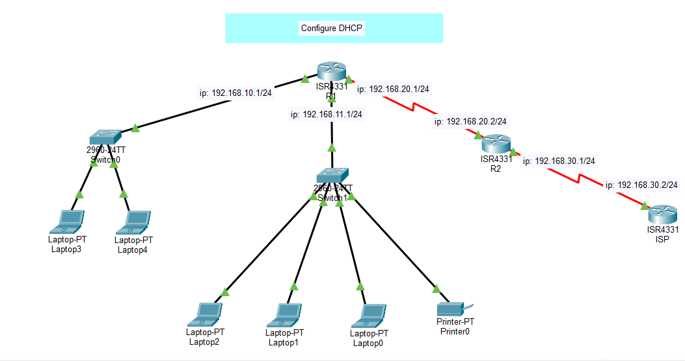
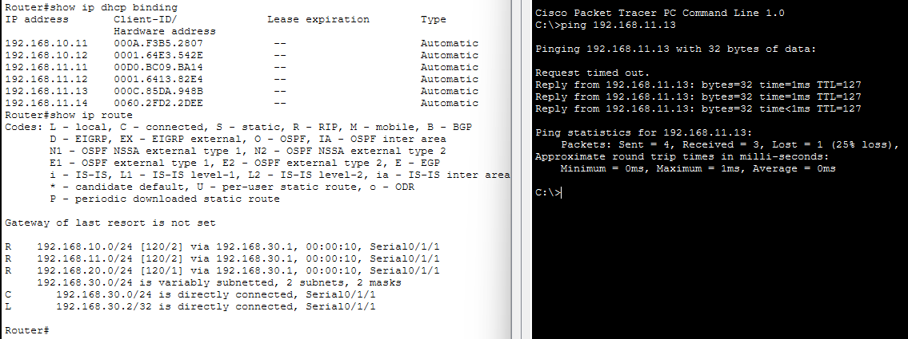

# Project 07: Centralized DHCP Server & DHCP Relay Agent

## Overview

This project demonstrates how to automate IPv4 address assignment across multiple remote networks using a **Centralized DHCP Server** and **DHCP Relay Agent (`ip helper-address`)** in Cisco Packet Tracer.

By default, routers do not forward broadcast packets—including DHCP Discover messages—between different subnets. Instead of deploying a separate DHCP server in every local network, this topology uses a central router (`ISP`) acting as the DHCP server for multiple remote LANs behind `R1` and `R2`. Dynamic routing (**RIPv2**) ensures full end-to-end reachability between the gateway router (`R1`) and the centralized DHCP server (`ISP`).

## Objectives

- Configure basic device security and management settings across all routers.
- Establish end-to-end IPv4 connectivity across three routers using **RIPv2**.
- Configure excluded IP address ranges on the centralized DHCP server to prevent IP conflicts with default gateways and static devices.
- Create multiple DHCP address pools (`LAN1` and `LAN2`) with default gateways, DNS servers, and domain names.
- Configure **DHCP Relay Agent** (`ip helper-address`) on `R1` LAN interfaces to convert DHCP broadcasts into unicast packets directed to the central server.
- Enable `spanning-tree portfast` on switch access ports for immediate DHCP address acquisition.
- Verify dynamic IP bindings and end-to-end network connectivity.

## Devices Used

- 3x Cisco ISR 4331 Routers (`R1`, `R2`, `ISP`).
- 2x Cisco Catalyst 2960-24TT Switches (`Switch0`, `Switch1`).
- 5x Laptops (`Laptop0` – `Laptop4`) & 1x Network Printer (`Printer0`).
- Cisco Packet Tracer.

---

## Network Topology & IP Addressing Plan

### 1. Router Interfaces

| Device | Interface | IP Address | Subnet Mask | Role / Description |
|---|---|---|---|---|
| **R1** | `GigabitEthernet0/0/0` | `192.168.10.1` | `255.255.255.0` | Gateway for LAN1 (DHCP Relay) |
| **R1** | `GigabitEthernet0/0/1` | `192.168.11.1` | `255.255.255.0` | Gateway for LAN2 (DHCP Relay) |
| **R1** | `Serial0/1/0` | `192.168.20.1` | `255.255.255.0` | WAN Link to R2 |
| **R2** | `Serial0/1/0` | `192.168.20.2` | `255.255.255.0` | WAN Link to R1 |
| **R2** | `Serial0/1/1` | `192.168.30.1` | `255.255.255.0` | WAN Link to ISP |
| **ISP** | `Serial0/1/1` | `192.168.30.2` | `255.255.255.0` | Centralized DHCP Server Interface |

### 2. DHCP Address Pools (Configured on `ISP`)

| Pool Name | Network | Excluded Range | Default Gateway | DNS Server | Domain Name |
|---|---|---|---|---|---|
| **LAN1** | `192.168.10.0/24` | `192.168.10.1` – `.10` | `192.168.10.1` | `8.8.8.8` | `bfic.com` |
| **LAN2** | `192.168.11.0/24` | `192.168.11.1` – `.10` | `192.168.11.1` | `8.8.8.8` | `bfic.com` |

---

## Device Configuration

### 1. Gateway & DHCP Relay Router (`R1`)

```cisco
enable
configure terminal

hostname R1
no ip domain-lookup
service password-encryption
enable secret class
banner motd #Unauthorized access is strictly prohibited.#

interface gigabitEthernet 0/0/0
 description LAN1 - Switch0
 ip address 192.168.10.1 255.255.255.0
 ip helper-address 192.168.30.2
 no shutdown
exit

interface gigabitEthernet 0/0/1
 description LAN2 - Switch1
 ip address 192.168.11.1 255.255.255.0
 ip helper-address 192.168.30.2
 no shutdown
exit

interface serial 0/1/0
 description Link to R2
 ip address 192.168.20.1 255.255.255.0
 no shutdown
exit

router rip
 version 2
 no auto-summary
 network 192.168.10.0
 network 192.168.11.0
 network 192.168.20.0
exit

```

### 2. Intermediate Router (`R2`)

```cisco
enable
configure terminal

hostname R2
no ip domain-lookup
service password-encryption
enable secret class
banner motd #Unauthorized access is strictly prohibited.#

interface serial 0/1/0
 description Link to R1
 ip address 192.168.20.2 255.255.255.0
 no shutdown
exit

interface serial 0/1/1
 description Link to ISP
 ip address 192.168.30.1 255.255.255.0
 no shutdown
exit

router rip
 version 2
 no auto-summary
 network 192.168.20.0
 network 192.168.30.0
exit

```

### 3. Centralized DHCP Server (`ISP`)

```cisco
enable
configure terminal

hostname ISP
no ip domain-lookup
service password-encryption
enable secret class
banner motd #Unauthorized access is strictly prohibited.#

interface serial 0/1/1
 description Link to R2
 ip address 192.168.30.2 255.255.255.0
 no shutdown
exit

ip dhcp excluded-address 192.168.10.1 192.168.10.10
ip dhcp excluded-address 192.168.11.1 192.168.11.10

ip dhcp pool LAN1
 network 192.168.10.0 255.255.255.0
 default-router 192.168.10.1
 dns-server 8.8.8.8
 domain-name bfic.com
exit

ip dhcp pool LAN2
 network 192.168.11.0 255.255.255.0
 default-router 192.168.11.1
 dns-server 8.8.8.8
 domain-name bfic.com
exit

router rip
 version 2
 no auto-summary
 network 192.168.30.0
exit

```

### 4. Access Switches (`Switch0` & `Switch1`)

```cisco
enable
configure terminal
no ip domain-lookup

interface range fastEthernet 0/1 - 10
 spanning-tree portfast
exit

```

---

## Key Concepts

* **DHCP Relay Agent (`ip helper-address`):** Because routers drop layer 2 broadcasts (`255.255.255.255`), configuring `ip helper-address` on the gateway interfaces (`R1`) intercepts client DHCP broadcasts and forwards them as **unicast** UDP packets directly to the centralized DHCP server (`192.168.30.2`).
* **Address Exclusion Best Practice:** Always configure `ip dhcp excluded-address` before defining the pool to reserve gateway and infrastructure IP addresses and prevent IP conflicts.
* **PortFast Integration:** Enabling `spanning-tree portfast` on user-facing switch ports allows end devices to bypass STP listening/learning delays and request a DHCP lease immediately upon link-up.

---

## Verification and Connectivity Testing

### 1. DHCP Bindings Verification (`ISP`)

```cisco
show ip dhcp binding

```

Confirmed active dynamic IP assignments across both remote subnets:

```text
IP address       Client-ID/              Lease expiration        Type
                 Hardware address
192.168.10.11    000A.F3B5.2807           --                     Automatic
192.168.10.12    0001.64E3.542E           --                     Automatic
192.168.11.11    0060.2FD2.2DEE           --                     Automatic
192.168.11.12    0001.6413.82E4           --                     Automatic
192.168.11.13    00D0.BC09.BA14           --                     Automatic
192.168.11.14    000C.85DA.948B           --                     Automatic

```

### 2. Routing Table Verification (`ISP`)

```cisco
show ip route
show ip protocols

```

Confirmed remote networks (`192.168.10.0/24` and `192.168.11.0/24`) learned dynamically via RIPv2 (`R`).

### 3. End-to-End Connectivity (Ping)

* All 6 end devices (`Laptop0`–`Laptop4` and `Printer0`) automatically obtained valid IP addresses, subnet masks, default gateways, and DNS settings.
* Ping tests between `LAN1` (`192.168.10.11`), `LAN2` (`192.168.11.11`), and the remote `ISP` router (`192.168.30.2`) succeeded with **0% packet loss**.

---

## Key Takeaways

Through this project, I gained practical experience with:

* Designing and configuring a centralized DHCP server serving multiple remote networks.
* Resolving broadcast limitations across routers using `ip helper-address`.
* Preventing IP conflicts using `ip dhcp excluded-address`.
* Combining dynamic routing (RIPv2) with enterprise IP addressing services.
* Verifying active DHCP leases using `show ip dhcp binding`.


## Screenshots

### 1. Network Topology

Shows the complete network topology connecting LAN1 and LAN2 through R1 and R2 to the centralized ISP DHCP server.



### 2. DHCP Verification & Connectivity Tests

Demonstrates successful DHCP address assignments, RIPv2 routing information, and end-to-end connectivity tests.




### 2. DHCP Verification & Connectivity Tests

Demonstrates active DHCP bindings on the `ISP` router (`show ip dhcp binding`), RIPv2 routes, and successful end-to-end Ping tests.

---

## Project Files

* `DHCP-Server-Relay.pkt` — Cisco Packet Tracer topology file.
* `screenshots/` — Network topology (`topology.png`) and CLI verification (`verification.png`) screenshots.
* `README.md` — Router/switch configurations and project documentation.

---

**Project 07/30 – 30 Projects in 30 Days**

*Learn. Practice. Build.*
